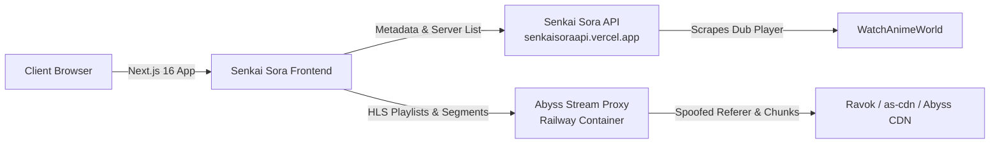

# 🌌 Senkai Sora — Modern Multilingual Anime Streaming Web App

[](https://nextjs.org/)
[](https://react.dev/)
[](https://www.typescriptlang.org/)
[](https://tailwindcss.com/)
[](https://videojs.org/)

**Senkai Sora** is a high-performance, responsive anime streaming web application built with Next.js, React, and Video.js 10. It enables seamless discovery and playback of anime in multiple regional languages (Japanese, English, Hindi, Tamil, Telugu, Malayalam, and Bangla) with real-time multi-audio track switching, intro/outro auto-skipping, dynamic stream proxying, and an ad-free glassmorphic user interface.

---

## 📑 Table of Contents

- [Features](#-features)
- [Architecture Overview](#-architecture-overview)
- [Getting Started](#-getting-started)
- [Environment Variables](#-environment-variables)
- [Developer Endpoints & API Reference](#-developer-endpoints--api-reference)
  - [1. Homepage & Catalog Feed](#1-homepage--catalog-feed)
  - [2. Anime Details & Season Guides](#2-anime-details--season-guides)
  - [3. Episode Data & Streaming Servers](#3-episode-data--streaming-servers)
  - [4. Stream Resolvers & Player Extraction](#4-stream-resolvers--player-extraction)
  - [5. Search & Real-Time Suggestions](#5-search--real-time-suggestions)
  - [6. Taxonomy & Category Filters](#6-taxonomy--category-filters)
  - [7. Standalone Movies](#7-standalone-movies)
  - [8. Developer Test Tools](#8-developer-test-tools)
- [Video Player Integration](#-video-player-integration)
- [Deployment](#-deployment)
- [License](#-license)

---

## ⚡ Features

- **🌐 Multilingual Audio Switching:** Switch seamlessly between Japanese (Original), English, Hindi, Tamil, and Telugu audio tracks in real time within HLS streams.
- **⏩ Smart Intro & Outro Skipping:** Automatically detects episode opening/ending ranges and provides instant one-click skip overlays.
- **🛡️ Dynamic HLS & MP4 Proxying:** Intercepts and proxies video streams through dedicated reverse-proxy servers to bypass IP-bound tokens, CORS restrictions, and hotlink protections.
- **🎨 Cinematic Glassmorphism:** Custom dark-themed UI featuring responsive carousels, backdrop spotlight previews, and fluid animations.
- **📱 Fully Responsive & Touch-Native:** Tailored for mobile, tablet, and desktop viewing with picture-in-picture (PiP) and Google Cast support.
- **🔍 Instant Autocomplete Search:** Real-time typeahead suggestions and comprehensive multi-criteria filtering (A–Z, Genres, Types).

---

## 🏗️ Architecture Overview



1. **Frontend (`/frontend`)**: Next.js 16 app rendering client-side Video.js 10 / Hls.js players and catalog views.
2. **API (`/api`)**: Express.js backend scraping catalog metadata, multi-season structures, and dub server identifiers.
3. **Stream Proxy (`/proxy`)**: Railway Docker container handling AES-256 decryption, HLS manifest rewriting, and chunk buffering.

---

## 🚀 Getting Started

### Prerequisites

- [Node.js](https://nodejs.org/) v18.18.0 or later
- npm or yarn

### Installation

```bash
# Clone the repository
git clone https://github.com/your-username/anime-stream-hindi.git
cd anime-stream-hindi/frontend

# Install dependencies
npm install

# Start development server
npm run dev
```

Open [http://localhost:3000](http://localhost:3000) in your browser.

---

## ⚙️ Environment Variables

Create `.env` in the `frontend/` root directory:

```env
# AnimeStream Backend API Base URL
api_base_url=https://senkaisoraapi.vercel.app/
API_BASE_URL=https://senkaisoraapi.vercel.app/
NEXT_PUBLIC_API_URL=https://senkaisoraapi.vercel.app/
NEXT_PUBLIC_API_BASE_URL=https://senkaisoraapi.vercel.app/

# Abyss Stream Proxy Railway URL & 32-bit Auth Token
abyss_proxy_url=https://abyss-proxies-production.up.railway.app/
NEXT_PUBLIC_ABYSS_PROXY_URL=https://abyss-proxies-production.up.railway.app/
ABYSS_AUTH_TOKEN=9c86dda4c5a4f2a5a30823e6d4dc7ce0
NEXT_PUBLIC_ABYSS_AUTH_TOKEN=9c86dda4c5a4f2a5a30823e6d4dc7ce0
```

---

## 📡 Developer Endpoints & API Reference

All backend requests are routed to `NEXT_PUBLIC_API_URL` (`https://senkaisoraapi.vercel.app/`). Click any endpoint below to expand the full documentation.

### 1. Homepage & Catalog Feed

<details>
<summary><strong>Get Homepage Feed & Spotlight</strong> — <code>GET /api/v1/animeworldin/home</code></summary>

<br />

Returns all 10 curated homepage sections (Spotlight carousel, Trending, Latest Drops, Top Airing, Popular, Movies, etc.).

**Endpoint:**
```http
GET /api/v1/animeworldin/home
GET /home
```

**Query Parameters:**
| Parameter | Type | Required | Description |
| :--- | :--- | :--- | :--- |
| `refresh` | `boolean` | No | Set `true` to bypass server cache |

**Response Schema:**
```json
{
  "success": true,
  "cached": false,
  "data": {
    "spotlight": [
      {
        "id": "series/jujutsu-kaisen",
        "title": "Jujutsu Kaisen",
        "banner": "https://.../banner.jpg",
        "image": "https://.../poster.jpg",
        "synopsis": "A boy fights curses...",
        "rating": "8.7"
      }
    ],
    "trending": [...],
    "newest-drops": [...],
    "most-popular": [...]
  }
}
```
</details>

---

### 2. Anime Details & Season Guides

<details>
<summary><strong>Get Anime Information & Episode Guide</strong> — <code>GET /api/v1/animeworldin/animeinfo/:id</code></summary>

<br />

Fetches full anime metadata, synopsis, genres, voice languages, and multi-season episode lists stitched into a single payload.

**Endpoint:**
```http
GET /api/v1/animeworldin/animeinfo/:id
GET /animeinfo/:id
```

**Parameters:**
| Parameter | Type | In | Description |
| :--- | :--- | :--- | :--- |
| `id` | `string` | Path | Anime slug (e.g. `series/solo-leveling` or `solo-leveling`) |

**Response Schema:**
```json
{
  "success": true,
  "data": {
    "id": "series/solo-leveling",
    "title": "Solo Leveling",
    "image": "https://.../poster.jpg",
    "genres": ["Action", "Fantasy"],
    "rating": "8.5",
    "seasons": [
      {
        "season": 1,
        "title": "Season 1",
        "episodes": [
          {
            "id": "episode/solo-leveling-1x1",
            "episode": 1,
            "title": "I'm Used to It",
            "image": "https://.../ep1.jpg"
          }
        ]
      }
    ]
  }
}
```
</details>

---

### 3. Episode Data & Streaming Servers

<details>
<summary><strong>Get Episode Details & Stream Servers Endpoint</strong> — <code>GET /episode/:id</code></summary>

<br />

Retrieves current episode details, previous/next links, and the stream server parameters (`abyssId`, `playXID`).

**Endpoint:**
```http
GET /episode/:id
```

**Parameters:**
| Parameter | Type | In | Description |
| :--- | :--- | :--- | :--- |
| `id` | `string` | Path | Episode slug (e.g. `jujutsu-kaisen-1x1`) |

**Response Schema:**
```json
{
  "success": true,
  "data": {
    "episodeId": "jujutsu-kaisen-1x1",
    "title": "Ryomen Sukuna",
    "runningEpisode": { "season": 1, "episode": 1 },
    "streamInfo": {
      "abyssId": "8073",
      "playXID": "0a09c8844ba8f0936c20bd791130d6b6",
      "serversEndpoint": "/stream/servers/?playXID=0a09c8844ba8f0936c20bd791130d6b6&abyssId=8073"
    }
  }
}
```
</details>

<details>
<summary><strong>Get Streaming Servers & Multi-Audio Sources</strong> — <code>GET /stream/servers/</code></summary>

<br />

Returns all streaming providers (**Abyss**, **PlayX / Sora**) along with regional dub tracks (Hindi, English, Japanese, Tamil, Telugu).

**Endpoint:**
```http
GET /stream/servers/?playXID=:playXID&abyssId=:abyssId
GET /stream/servers/:streamId
```

**Query Parameters:**
| Parameter | Type | Required | Description |
| :--- | :--- | :--- | :--- |
| `playXID` | `string` | Optional | 32-character hex ID for Ravok / PlayX server |
| `abyssId` | `string` | Optional | Numeric stream ID for Abyss dub player |

**Response Schema:**
```json
{
  "success": true,
  "data": {
    "streamId": "8073",
    "servers": [
      {
        "serverName": "abyss",
        "server": "ABYSS",
        "languages": [
          { "language": "Hindi", "code": "hin", "video_id": "YaXd-lvb0" },
          { "language": "Japanese", "code": "jpn", "video_id": "k1RERPJ7W" }
        ]
      },
      {
        "serverName": "playx",
        "server": "PlayX",
        "streamUrl": "https://abyss-proxies-production.up.railway.app/player/stream/proxy?url=...",
        "languages": [
          { "language": "multi", "code": "multi", "video_id": "0a09c8844ba8f0936c20bd791130d6b6" }
        ]
      }
    ],
    "defaultSource": {
      "serverName": "abyss",
      "language": "Hindi",
      "video_id": "YaXd-lvb0"
    }
  }
}
```
</details>

---

### 4. Stream Resolvers & Player Extraction

<details>
<summary><strong>Resolve Abyss Stream Video (MP4 / HLS Chunks)</strong> — <code>GET /resolve/:videoId</code></summary>

<br />

Directly queries the dedicated Railway proxy to resolve an Abyss video ID into progressive MP4 streams and dynamic playlists.

**Endpoint:**
```http
GET https://abyss-proxies-production.up.railway.app/resolve/:videoId?token=:token
```

**Parameters & Headers:**
| Name | Type | In | Description |
| :--- | :--- | :--- | :--- |
| `videoId` | `string` | Path | Abyss video slug (e.g. `YaXd-lvb0`) |
| `token` | `string` | Query / Header | 32-bit authorization token (`x-auth-token`) |

**Response Schema:**
```json
{
  "success": true,
  "id": "YaXd-lvb0",
  "availableResolutions": ["1080p", "720p", "360p"],
  "streamUrl": "https://abyss-proxies-production.up.railway.app/stream/YaXd-lvb0?token=...",
  "sources": [
    {
      "label": "1080p",
      "codec": "h264",
      "directStreamUrl": "https://abyss-proxies-production.up.railway.app/stream/YaXd-lvb0?res=1080p&token=...",
      "directHlsPlaylist": "https://abyss-proxies-production.up.railway.app/hls/YaXd-lvb0/playlist.m3u8?res=1080p&token=..."
    }
  ]
}
```
</details>

<details>
<summary><strong>Get PlayX / Sora Stream Metadata, Intro/Outro & Subtitles</strong> — <code>GET /player/data/:videoId</code></summary>

<br />

Extracts Ravok stream URLs, intro/outro timestamps (e.g. `55-144`), AES-256 decryption keys, and disguised subtitle tracks converted to WebVTT.

**Endpoint:**
```http
GET https://abyss-proxies-production.up.railway.app/player/data/:videoId
GET /api/player/data/:videoId
```

**Response Schema:**
```json
{
  "success": true,
  "videoId": "0a09c8844ba8f0936c20bd791130d6b6",
  "title": "Jujutsu Kaisen - Episode 1",
  "intro": { "start": 55, "end": 144, "duration": 89, "enabled": true },
  "outro": { "start": 0, "end": 0, "duration": 0, "enabled": false },
  "hls": true,
  "streamProxyUrl": "https://abyss-proxies-production.up.railway.app/player/stream/proxy?url=...",
  "subtitles": [
    {
      "label": "English",
      "language": "eng",
      "proxyUrl": "https://abyss-proxies-production.up.railway.app/player/subtitle/proxy?url=..."
    }
  ]
}
```
</details>

<details>
<summary><strong>Proxied HLS Stream & Segment Router</strong> — <code>GET /player/stream/proxy</code></summary>

<br />

Proxies the master `.m3u8`, child resolution playlists, and individual media segments (`.js` / `.ts` / fMP4 chunks) with spoofed referer headers.

**Endpoint:**
```http
GET https://abyss-proxies-production.up.railway.app/player/stream/proxy?url=:targetUrl&videoId=:videoId
```

**Query Parameters:**
| Parameter | Type | Required | Description |
| :--- | :--- | :--- | :--- |
| `url` | `string` | Yes | URL-encoded upstream `.m3u8` or segment URL |
| `videoId` | `string` | Optional | Video ID for auto-healing 403 token expirations |

**Response:**
Returns `#EXTM3U` content with rewritten proxy URLs or binary `video/MP2T` chunks with open CORS (`Access-Control-Allow-Origin: *`).
</details>

---

### 5. Search & Real-Time Suggestions

<details>
<summary><strong>Full-Text Search with Pagination</strong> — <code>GET /search</code></summary>

<br />

Searches anime titles with pagination support.

**Endpoint:**
```http
GET /search?s=:query&page=:page
```

**Query Parameters:**
| Parameter | Type | Required | Description |
| :--- | :--- | :--- | :--- |
| `s` | `string` | Yes | Search query string (e.g. `naruto`) |
| `page` | `number` | No | Page number (default: `1`) |

**Response Schema:**
```json
{
  "success": true,
  "query": "naruto",
  "page": 1,
  "totalPages": 4,
  "hasNextPage": true,
  "results": [
    {
      "id": "series/naruto-shippuden",
      "title": "Naruto Shippuden",
      "image": "https://.../poster.jpg",
      "rating": "8.7"
    }
  ]
}
```
</details>

<details>
<summary><strong>Instant Autocomplete Suggestions</strong> — <code>GET /search-suggestion</code></summary>

<br />

Lightweight typeahead endpoint designed for search bar autocomplete popups.

**Endpoint:**
```http
GET /search-suggestion?term=:query
```

**Response Schema:**
```json
{
  "success": true,
  "term": "jujutsu",
  "totalResults": 2,
  "suggestions": [
    {
      "id": "series/jujutsu-kaisen",
      "title": "Jujutsu Kaisen",
      "image": "https://.../thumb.jpg",
      "year": "2020"
    }
  ]
}
```
</details>

---

### 6. Taxonomy & Category Filters

<details>
<summary><strong>Browse by Genre</strong> — <code>GET /genre/:genre</code></summary>

<br />

Returns paginated anime items belonging to a specific genre.

**Endpoint:**
```http
GET /genre/:genre?page=:page
```

**Parameters:**
| Parameter | Type | In | Description |
| :--- | :--- | :--- | :--- |
| `genre` | `string` | Path | Genre slug (e.g. `action`, `shounen`, `fantasy`, `romance`) |
| `page` | `number` | Query | Page number |
</details>

<details>
<summary><strong>Browse A–Z Alphabetical Index</strong> — <code>GET /az-list/:letter</code></summary>

<br />

Retrieves anime titles beginning with a specific letter or numeric symbol (`0-9`).

**Endpoint:**
```http
GET /az-list/:letter?page=:page
```

**Parameters:**
| Parameter | Type | In | Description |
| :--- | :--- | :--- | :--- |
| `letter` | `string` | Path | Single character `a`–`z` or `0-9` |
</details>

<details>
<summary><strong>Browse by Category / Taxonomy</strong> — <code>GET /category/:slug</code></summary>

<br />

Filters catalog by category taxonomy (e.g. `anime`, `cartoons`, `dubbed`, `subbed`).

**Endpoint:**
```http
GET /category/:slug?page=:page
```
</details>

---

### 7. Standalone Movies

<details>
<summary><strong>Get Standalone Movie Details & Stream</strong> — <code>GET /movie/:id</code></summary>

<br />

Extracts metadata, synopsis, dub languages, and stream IDs for standalone anime feature films.

**Endpoint:**
```http
GET /movie/:id
```

**Parameters:**
| Parameter | Type | In | Description |
| :--- | :--- | :--- | :--- |
| `id` | `string` | Path | Movie slug (e.g. `jujutsu-kaisen-0` or `your-name`) |
</details>

---

### 8. Developer Test Tools

<details>
<summary><strong>Developer Test Tools & Diagnostics</strong> — <code>/dev/extract</code> & <code>/dev/iframe</code></summary>

<br />

Interactive in-browser testing consoles hosted on the API server:
- **Scraper HTML Extractor:** `https://senkaisoraapi.vercel.app/dev/extract`
- **Iframe Proxy Live Tester:** `https://senkaisoraapi.vercel.app/dev/iframe`
- **Proxy Stream Tester:** `https://abyss-proxies-production.up.railway.app/player`
</details>

---

## 🎬 Video Player Integration

The frontend utilizes a custom `AnimeVideoPlayer` built on Video.js 10 and Hls.js:

```tsx
import { AnimeVideoPlayer } from "@/components/AnimeVideoPlayer";

<AnimeVideoPlayer
  title="Jujutsu Kaisen"
  episodeTitle="Ryomen Sukuna"
  seasonNumber={1}
  episodeNumber={1}
  serverName="sora"
  qualities={[
    { label: "1080p (Sora)", url: streamProxyUrl },
    { label: "Auto", url: streamProxyUrl },
  ]}
  currentQuality="1080p (Sora)"
  onQualityChange={(q) => handleQualityChange(q)}
  intro={{ start: 55, end: 144, enabled: true }}
  subtitles={subtitlesList}
  autoSkipIntro={true}
/>
```

---

## 📦 Deployment

### Deploy on Vercel

The frontend is optimized for deployment on Vercel:

1. Push your code to GitHub.
2. Import the project into the [Vercel Dashboard](https://vercel.com/new).
3. Set the Root Directory to `frontend`.
4. Configure environment variables (`NEXT_PUBLIC_API_URL`, `NEXT_PUBLIC_ABYSS_PROXY_URL`, `NEXT_PUBLIC_ABYSS_AUTH_TOKEN`).
5. Deploy.

---

## 📄 License

This project is licensed under the MIT License — see the [LICENSE](file:///e:/anime-stream-hindi/LICENSE) file for details. Built for educational and non-commercial streaming research.
