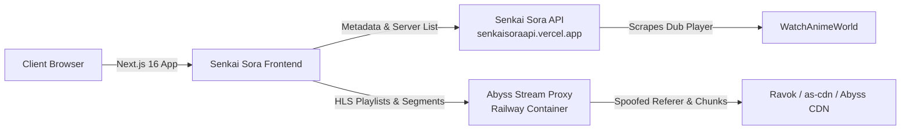

# 🌌 Senkai Sora — Modern Multilingual Anime Streaming Web App

[](https://nextjs.org/)
[](https://react.dev/)
[](https://www.typescriptlang.org/)
[](https://tailwindcss.com/)
[](https://videojs.org/)

**Senkai Sora** is a modern, responsive multilingual anime streaming frontend built with Next.js, React, and Video.js 10. It enables seamless discovery and playback of anime in multiple regional languages (Japanese, English, Hindi, Tamil, Telugu, Malayalam, and Bangla) with real-time multi-audio track switching, intro/outro auto-skipping, dynamic stream proxying, and an ad-free glassmorphic user interface.

---

## 📑 Table of Contents

- [Features](#-features)
- [Architecture Overview](#-architecture-overview)
- [Getting Started](#-getting-started)
- [Environment Variables](#-environment-variables)
- [Video Player Integration](#-video-player-integration)
- [Project Structure](#-project-structure)
- [Deployment](#-deployment)
- [License](#-license)

---

## ⚡ Features

- **🌐 Multilingual Audio Switching:** Switch seamlessly between Japanese (Original), English, Hindi, Tamil, and Telugu audio tracks in real time within HLS streams.
- **⏩ Smart Intro & Outro Skipping:** Automatically detects episode opening and ending ranges and provides instant one-click skip overlays.
- **🛡️ Dynamic HLS & MP4 Proxying:** Intercepts and proxies video streams through dedicated reverse-proxy servers to bypass IP-bound tokens, CORS restrictions, and hotlink protections.
- **🎨 Cinematic Glassmorphism:** Custom dark-themed UI featuring responsive carousels, backdrop spotlight previews, and fluid animations.
- **📱 Fully Responsive & Touch-Native:** Tailored for mobile, tablet, and desktop viewing with picture-in-picture (PiP) and Google Cast support.
- **🔍 Instant Autocomplete Search:** Real-time typeahead suggestions and comprehensive multi-criteria filtering (A–Z, Genres, Types).

---

## 🏗️ Architecture Overview



1. **Frontend (`/frontend`)**: Next.js 16 app rendering client-side Video.js 10 / Hls.js players and catalog views.
2. **API (`/api`)**: Express.js backend scraping catalog metadata, multi-season structures, and dub server identifiers.
3. **Stream Proxy (`/proxy`)**: Railway Docker container handling AES-256 decryption, HLS manifest rewriting, and chunk buffering.

---

## 🚀 Getting Started

### Prerequisites

- [Node.js](https://nodejs.org/) v18.18.0 or later
- npm, yarn, or pnpm

### Installation

```bash
# Clone the repository
git clone https://github.com/NicoLoop/Senkai-Sora.git
cd Senkai-Sora

# Install dependencies
npm install

# Start development server
npm run dev
```

Open [http://localhost:3000](http://localhost:3000) in your browser.

---

## ⚙️ Environment Variables

Create `.env` or `.env.local` in the `frontend/` root directory:

```env
# AnimeStream Backend API Base URL
api_base_url=https://senkaisoraapi.vercel.app/
API_BASE_URL=https://senkaisoraapi.vercel.app/
NEXT_PUBLIC_API_URL=https://senkaisoraapi.vercel.app/
NEXT_PUBLIC_API_BASE_URL=https://senkaisoraapi.vercel.app/

# Abyss Stream Proxy Railway URL & 32-bit Auth Token
abyss_proxy_url=https://abyss-proxies-production.up.railway.app/
NEXT_PUBLIC_ABYSS_PROXY_URL=https://abyss-proxies-production.up.railway.app/
ABYSS_AUTH_TOKEN=9c86dda4c5a4f2a5a30823e6d4dc7ce0
NEXT_PUBLIC_ABYSS_AUTH_TOKEN=9c86dda4c5a4f2a5a30823e6d4dc7ce0
```

---

## 🎬 Video Player Integration

The frontend utilizes a custom `AnimeVideoPlayer` component built on Video.js 10 and Hls.js with native audio track switching and intro/outro markers:

```tsx
import { AnimeVideoPlayer } from "@/components/AnimeVideoPlayer";

<AnimeVideoPlayer
  title="Jujutsu Kaisen"
  episodeTitle="Ryomen Sukuna"
  seasonNumber={1}
  episodeNumber={1}
  serverName="sora"
  qualities={[
    { label: "1080p (Sora)", url: streamProxyUrl },
    { label: "Auto", url: streamProxyUrl },
  ]}
  currentQuality="1080p (Sora)"
  onQualityChange={(newQuality) => setCurrentQuality(newQuality)}
  intro={{ start: 55, end: 144, enabled: true }}
  subtitles={subtitlesList}
  autoSkipIntro={true}
/>
```

---

## 📂 Project Structure

```
frontend/
├── public/                 # Static assets, hero backdrops, and branding
├── src/
│   ├── app/                # Next.js App Router pages and layouts
│   │   ├── [...id]/        # Dynamic route for anime series and episode playback
│   │   ├── watch/[...id]/  # Dedicated watch router
│   │   ├── search/         # Search page with autocomplete
│   │   ├── az-list/        # A–Z directory
│   │   ├── genre/          # Genre filter catalog
│   │   └── movies/         # Standalone movies
│   ├── components/         # Reusable UI & Video Player components
│   │   ├── AnimeVideoPlayer.tsx # Core Video.js 10 + Hls.js player
│   │   ├── Navbar.tsx      # Glassmorphic top navigation bar
│   │   ├── SidebarRail.tsx # Minimal side menu
│   │   └── SpotlightHero.tsx # Cinematic banner carousel
│   ├── data/               # Type definitions and static anime data
│   ├── services/           # Backend API integration client (api.ts)
│   └── utils/              # Cookie storage and watch progress trackers
├── .env.example            # Environment configuration template
├── package.json
└── tsconfig.json
```

---

## 📦 Deployment

### Deploy on Vercel

The frontend is optimized for deployment on Vercel:

1. Push your code to GitHub.
2. Import the project into the [Vercel Dashboard](https://vercel.com/new).
3. Set the Root Directory to `frontend`.
4. Configure environment variables (`NEXT_PUBLIC_API_URL`, `NEXT_PUBLIC_ABYSS_PROXY_URL`, `NEXT_PUBLIC_ABYSS_AUTH_TOKEN`).
5. Deploy.

---

## 📄 License

This project is licensed under the MIT License — see the [LICENSE](LICENSE) file for details. Built purely for educational, non-commercial streaming research.
